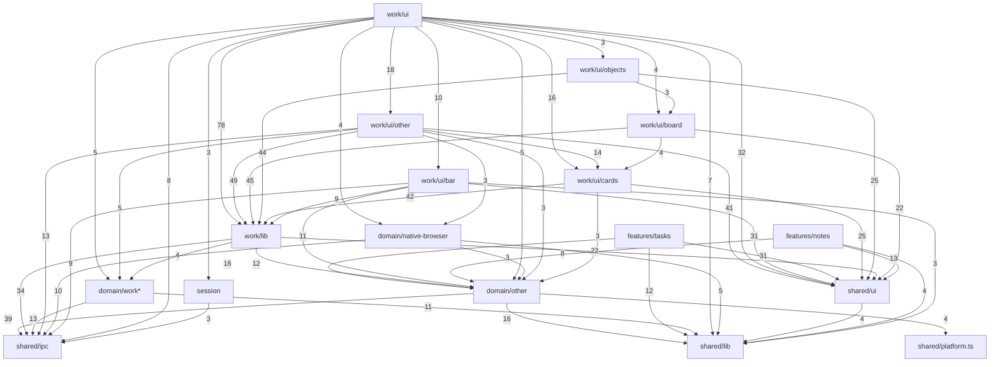
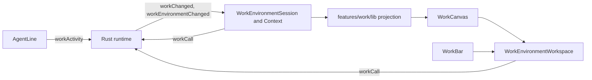
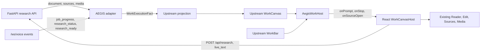

# Work dependency graph

Generated from a static import trace of upstream commit `7ccc28ff1cb102aba69ef4415fee266b8239fa0d`, starting at `WorkEnvironmentWorkspace.svelte`. Numbers on arrows count imports between modules; links with fewer than 3 imports are hidden. File-level detail is in `WORK_FILE_INVENTORY.md`.

| Set | Files | Lines | Native commands |
|---|---:|---:|---:|
| Full workspace | 462 | 92,500 | 135 |
| Core: canvas, composer, lift, board projection | 308 | 62,433 | 43 |

External packages, with the number of importing files: @hugeicons/core-free-icons (211), svelte (130), @hugeicons/svelte (22), @tiptap/core (11), @tiptap/pm (11), @xyflow/svelte (10), bits-ui (7), @tauri-apps/api (4), elkjs (2), marked (2), @tiptap/extension-document (1), @tiptap/extension-paragraph (1), @tiptap/extension-text (1), @tiptap/extension-heading (1), @tiptap/extension-bold (1), @tiptap/extension-italic (1), @tiptap/extension-strike (1), @tiptap/extension-code (1), @tiptap/extension-blockquote (1), @tiptap/extension-bullet-list (1), @tiptap/extension-ordered-list (1), @tiptap/extension-list-item (1), @tiptap/extension-code-block (1), @tiptap/extension-horizontal-rule (1), @tiptap/extension-hard-break (1).

## Imports between modules

## Zephium at runtime

## Proposed AEGIS runtime

